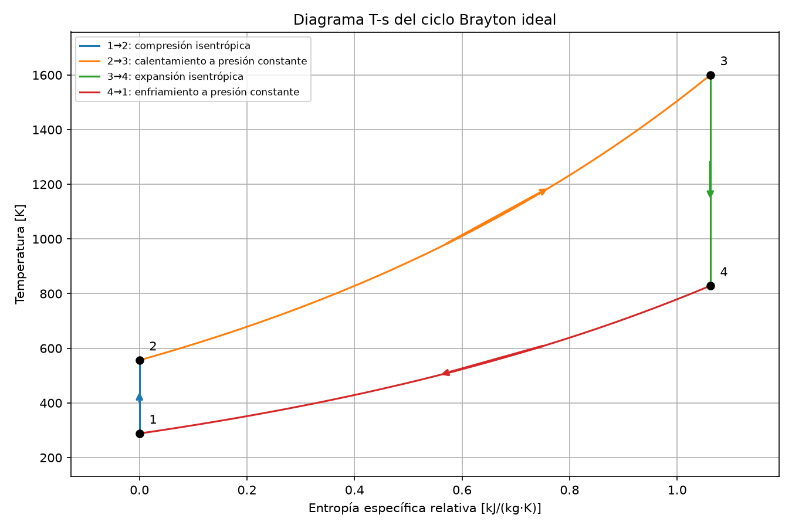
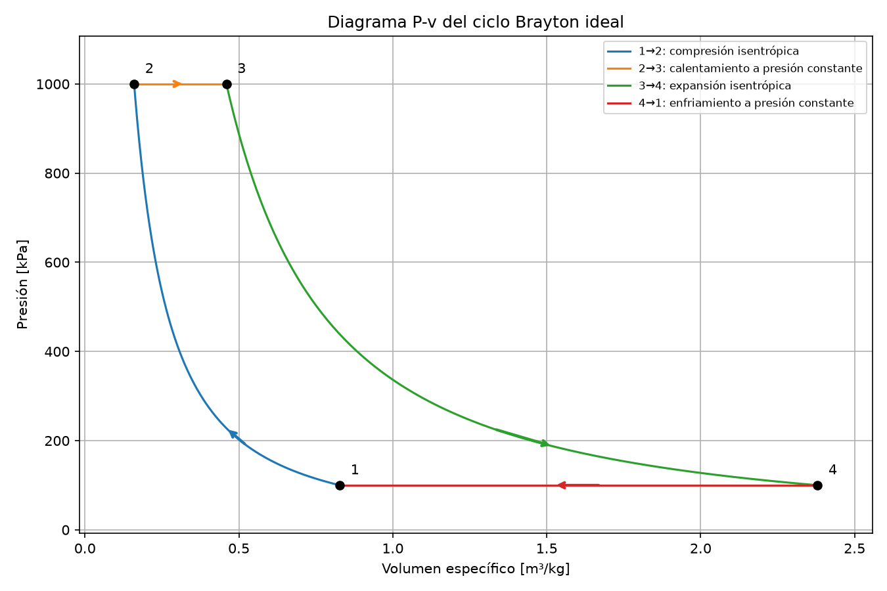
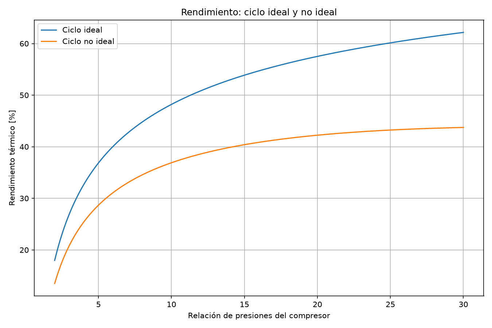
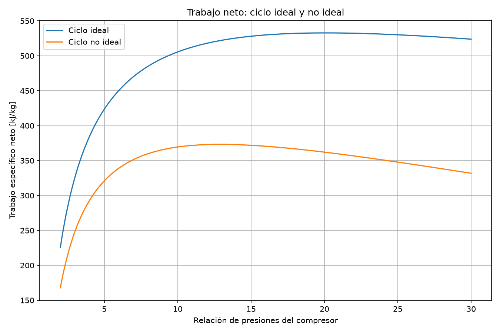

# Brayton Cycle Simulator

## Overview

An educational Python simulator for studying gas turbine thermodynamics through ideal and simplified non-ideal Brayton cycles. It calculates cycle states, energy balances and pressure-ratio trends, and saves thermodynamic diagrams for inspection.

## Objectives

- Apply thermodynamics and propulsion concepts to an engineering problem.
- Learn scientific programming with Python.
- Perform parametric analyses and interpret their results.
- Generate thermodynamic diagrams with consistent units.
- Learn a development workflow using VS Code, Codex, Git and GitHub.

## Features

- Ideal-cycle temperatures, thermal efficiency and specific energy balances.
- An ordered efficiency table for pressure ratios of 5, 10, 15, 20 and 25.
- Ideal-cycle relative entropies, pressures and specific volumes.
- Ideal T-s and P-v diagrams with numbered states, curved thermodynamic processes and direction arrows.
- Analytical ideal-cycle net-work optimization, checked against a NumPy search over 100,001 pressure ratios from 1.01 to 50.
- A separate non-ideal model with compressor and turbine isentropic efficiencies and combustor pressure loss.
- Terminal comparison of ideal and non-ideal temperatures, pressures, energy balances, efficiencies and back work ratios.
- Efficiency and net-work comparisons over compressor pressure ratios from 2 to 30.
- Physical input validation and runtime consistency checks, including recovery of the ideal cycle when both component efficiencies are 1 and pressure loss is zero.
- Six PNG plots saved beside `main.py` using Matplotlib's `Agg` backend, without opening windows.

## Thermodynamic model

Both models use an ideal gas with constant specific heat $c_p$ and heat-capacity ratio $\gamma=c_p/c_v$. Compressor and turbine balances assume steady, adiabatic flow and neglect changes in kinetic and potential energy.

States are: **1**, compressor inlet; **2**, compressor outlet; **3**, turbine inlet; **4**, turbine outlet. Define the compressor pressure ratio as $r_p=p_2/p_1$ and $a=(\gamma-1)/\gamma$.

### Ideal cycle

Compression and expansion are isentropic. Heat addition and rejection occur at constant pressure, with $p_2=p_3=r_pp_1$ and $p_4=p_1$:

$$
T_2=T_1r_p^a,\qquad T_4=\frac{T_3}{r_p^a},\qquad
\eta_{th,ideal}=1-\frac{1}{r_p^a}.
$$

With $c_p$ in J/(kg·K), the following specific energies are in kJ/kg. Compressor work is reported as a positive consumption:

$$
\begin{aligned}
w_c&=\frac{c_p(T_2-T_1)}{1000}, &
w_t&=\frac{c_p(T_3-T_4)}{1000},\\
w_{net}&=w_t-w_c, &
q_{in}&=\frac{c_p(T_3-T_2)}{1000},\\
\eta_{th}&=\frac{w_{net}}{q_{in}}, &
\mathrm{BWR}&=\frac{w_c}{w_t}.
\end{aligned}
$$

The program checks that the energy-balance efficiency matches the ideal formula. At fixed inlet and maximum temperatures, maximum ideal net work occurs at:

$$
r_{p,opt}=\left(\frac{T_3}{T_1}\right)^{\gamma/[2(\gamma-1)]}.
$$

Relative entropy uses $s_1=0$, $s_2=s_1$, and $s_4=s_3$. On an isobar:

$$
\Delta s=\frac{c_p}{1000}\ln\left(\frac{T_{final}}{T_{initial}}\right).
$$

Entropy is expressed in kJ/(kg·K). The program checks that $\Delta s_{2\to3}=\Delta s_{1\to4}$. The T-s isobars follow this logarithmic relation.

The P-v calculation uses:

$$
R=c_p\left(1-\frac{1}{\gamma}\right),\qquad
v=\frac{RT}{P},\qquad Pv^\gamma=\text{constant on an isentrope}.
$$

Here $R$ is in J/(kg·K), $P$ must be in Pa for the gas equation, and $v$ is in m³/kg. The code converts its kPa pressures to Pa when calculating volumes and checking $Pv=RT$.

### Non-ideal cycle

Let $\delta$ be the relative combustor pressure loss. The model uses:

$$
\begin{aligned}
T_{2s}&=T_1r_p^a, &
T_2&=T_1+\frac{T_{2s}-T_1}{\eta_c},\\
p_2&=p_1r_p, &
p_3&=p_2(1-\delta),\qquad p_4=p_1,\\
T_{4s}&=T_3\left(\frac{p_4}{p_3}\right)^a, &
T_4&=T_3-\eta_t(T_3-T_{4s}).
\end{aligned}
$$

The suffix **s** denotes an isentropic reference at the corresponding inlet and outlet pressures; $T_2$ and $T_4$ are the non-ideal component outlet temperatures. Because of combustor pressure loss, the non-ideal $T_{4s}$ differs from the ideal-cycle $T_4$.

The same energy-balance equations above apply to the non-ideal temperatures. Heat addition remains represented by $c_p(T_3-T_2)$; fuel chemistry and fuel mass addition are not modeled. The code requires $0<\eta_c,\eta_t\leq1$, $0\leq\delta<1$, positive finite states, $p_3>p_4$, positive heat input and positive net work.

## Example parameters

Current values defined in `main.py`:

| Parameter | Value |
|---|---:|
| Compressor inlet temperature, $T_1$ | 288.15 K |
| Turbine inlet temperature, $T_3$ | 1600 K |
| Compressor pressure ratio, $r_p$ | 10 |
| Heat-capacity ratio, $\gamma$ | 1.4 |
| Specific heat, $c_p$ | 1005 J/(kg·K) |
| Compressor inlet pressure, $p_1$ | 100 kPa |
| Compressor isentropic efficiency, $\eta_c$ | 0.85 |
| Turbine isentropic efficiency, $\eta_t$ | 0.90 |
| Relative combustor pressure loss, $\delta$ | 0.05 (5%) |

Derived pressures are 1000 kPa at states 2 and 3 of the ideal cycle. In the non-ideal cycle, $p_2=1000$ kPa and $p_3=950$ kPa. Both models use $p_4=100$ kPa.

## Example results

Results verified by executing the current code with the parameters above; values are rounded for presentation:

| Quantity | Ideal | Non-ideal |
|---|---:|---:|
| $T_{2s}$ [K] | 556.33 | 556.33 |
| $T_2$ [K] | 556.33 | 603.66 |
| $T_{4s}$ [K] | 828.72 | 840.95 |
| $T_4$ [K] | 828.72 | 916.86 |
| Compressor work [kJ/kg] | 269.52 | 317.08 |
| Turbine work [kJ/kg] | 775.14 | 686.56 |
| Net work [kJ/kg] | 505.62 | 369.48 |
| Heat input [kJ/kg] | 1048.89 | 1001.33 |
| Thermal efficiency [%] | 48.21 | 36.90 |
| Back work ratio [-] | 0.3477 | 0.4618 |

For the ideal cycle, $s_1=s_2=0$ and $s_3=s_4=1.061678$ kJ/(kg·K). The derived gas constant is 287.142857 J/(kg·K).

The ideal net-work optimum is **20.085256** analytically and **20.085236** numerically. At the analytical optimum, net work is **532.802230 kJ/kg**, $T_2=T_4=679.00$ K and thermal efficiency is **57.56%**. The two pressure ratios agree within the numerical grid spacing of approximately 0.000490.

## Generated plots


Ideal thermal efficiency versus pressure ratio from 2 to 30.



Ideal T-s diagram with vertical isentropic stages and curved constant-pressure heat addition and rejection.



Ideal P-v diagram with curved isentropic compression and expansion, horizontal isobars and cycle-direction arrows.


Ideal specific net work from pressure ratio 1.01 to 50, with the analytical maximum marked and checked numerically.



Thermal efficiency comparison from pressure ratio 2 to 30 with the specified component efficiencies and combustor pressure loss.



Specific net-work comparison over the same pressure-ratio range.

## Project structure

```text
Brayton_Simulator/
├── main.py
├── requirements.txt
├── README.md
├── .gitignore
├── rendimiento_brayton.png
├── diagrama_ts_brayton.png
├── diagrama_pv_brayton.png
├── trabajo_neto_vs_rp.png
├── comparacion_ideal_noideal.png
└── trabajo_neto_ideal_noideal.png
```

## Installation

Install Python 3 and Git. In Windows PowerShell, replace `YOUR_REPOSITORY_URL` with this repository's clone URL:

```powershell
git clone YOUR_REPOSITORY_URL Brayton_Simulator
cd Brayton_Simulator
python -m venv .venv
.\.venv\Scripts\Activate.ps1
pip install -r requirements.txt
```

If PowerShell does not allow activation, install dependencies directly through the virtual environment:

```powershell
.\.venv\Scripts\python.exe -m pip install -r requirements.txt
```

The local `.venv` directory is excluded by `.gitignore` and is not part of the repository.

## Usage

From the repository directory, with the virtual environment active:

```powershell
python main.py
```

Alternatively, on Windows:

```powershell
.\.venv\Scripts\python.exe main.py
```

The program prints cycle results and consistency checks, then saves or overwrites the six PNG files beside `main.py`. It does not open plot windows. To explore other cases, edit the parameter assignments in `main.py`; there is currently no command-line parameter interface. Terminal messages and plot labels are currently in Spanish.

## Technologies

- **Python** — thermodynamic functions and runtime checks.
- **NumPy** — pressure-ratio grids, arrays and numerical maximum search.
- **Matplotlib** — plots and thermodynamic diagrams using `Agg`.
- **Git and GitHub** — version control and repository hosting.
- **VS Code and Codex** — editor and development assistance.

## Limitations

- This is an educational, simplified cycle model, not a detailed gas turbine engine model.
- Gas properties are constant; temperature-dependent heat capacities and combustion-product composition are not represented.
- Non-ideal behavior is limited to fixed isentropic efficiencies and combustor pressure loss. Mechanical losses, fuel consumption, thrust and component maps are not calculated.
- T-s and P-v diagrams and analytical net-work optimization currently describe only the ideal cycle.
- Pressure-ratio ranges are fixed in the code. Invalid or non-motor conditions raise errors rather than being skipped; changing parameters may make a full sweep infeasible.
- Consistency checks run with the program; the repository currently has no standalone automated test suite.

## Future improvements

Potential future work, not currently implemented:

- Add automated tests and separate the thermodynamic model from plotting and execution.
- Accept parameters through a configuration file or command-line arguments.
- Add non-ideal thermodynamic diagrams and net-work optimization.
- Explore temperature-dependent gas properties and regenerative cycles.

## Author / Context

A personal aerospace engineering learning project.
